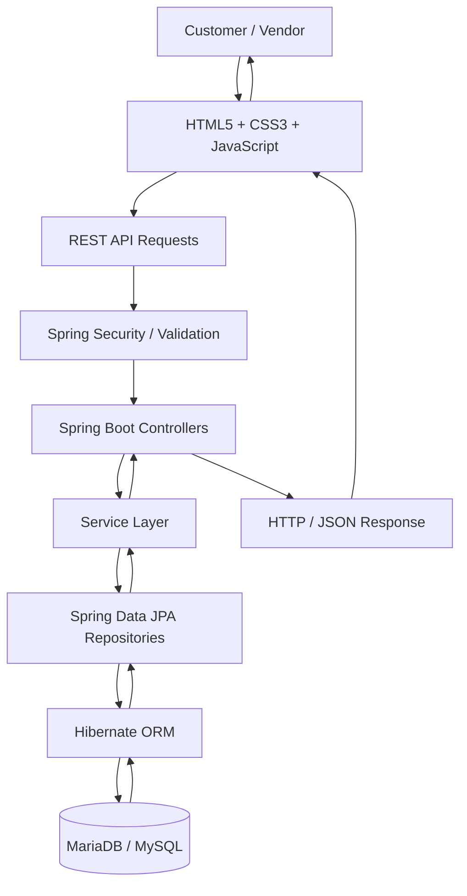
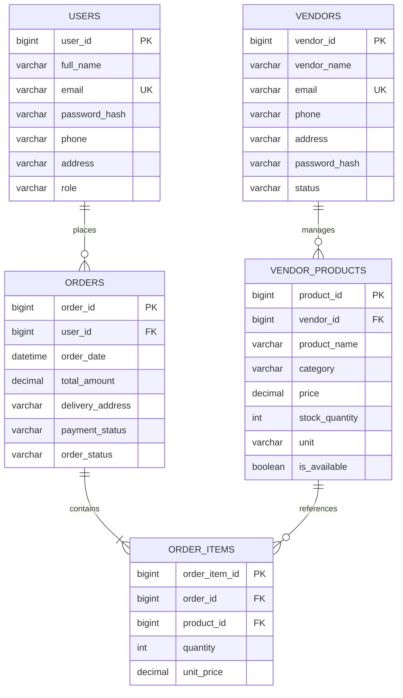

# 🛒 GroceryMate — Smart Grocery Management System

<p align="center">
  
  
  
  
</p>

<p align="center">
  
  
  
</p>

<p align="center">
  <b>Smart Shopping. Better Stock Management. Less Waste.</b>
  <br/>
  A full-stack grocery management platform connecting customers and vendors through a unified digital experience.
</p>

---


## 📌 Table of Contents

- [Overview](#-overview)
- [Project Objectives](#-project-objectives)
- [Features](#-features)
- [Application Screenshots](#-application-screenshots)
- [Technology Stack](#-technology-stack)
- [System Architecture](#-system-architecture)
- [Database Design](#-database-design)
- [Project Structure](#-project-structure)
- [Prerequisites](#-prerequisites)
- [Installation and Setup](#-installation-and-setup)
- [Configuration](#-configuration)
- [Running the Application](#-running-the-application)
- [REST API Overview](#-rest-api-overview)
- [Security](#-security)
- [Testing](#-testing)
- [Future Enhancements](#-future-enhancements)
- [Contributing](#-contributing)
- [License](#-license)
- [Acknowledgements](#-acknowledgements)

---

## 🛍️ Overview

**GroceryMate** is a full-stack web application designed to simplify grocery management for customers and vendors.

Customers can manage grocery requirements, track purchases, monitor estimated consumption periods, and receive reminders before essential items run out. Vendors can manage product listings, maintain inventory, monitor stock availability, and handle customer orders.

The application combines a responsive frontend with a Java Spring Boot backend and a relational database to provide a connected grocery management experience.

### 🎯 The Problem

Managing groceries manually can lead to forgotten essentials, unnecessary shopping trips, poor inventory visibility, and inefficient stock management for local vendors.

### 💡 Our Solution

GroceryMate provides a centralized platform that helps customers stay organized while enabling vendors to manage products and orders digitally.

---

## 🎯 Project Objectives

- Simplify everyday grocery management.
- Help customers keep track of grocery requirements and purchase schedules.
- Provide vendors with digital inventory management tools.
- Connect frontend interactions with backend REST APIs.
- Maintain structured and consistent data using a relational database.
- Build a responsive and user-friendly web application.

---

## ✨ Features

### 👤 Customer Features

- **User Authentication:** Register and sign in securely.
- **Grocery Management:** Maintain grocery requirements and purchase information.
- **Consumption Tracking:** Record the average number of days required to finish an item.
- **Smart Reminders:** Configure reminders before an item is expected to run out.
- **Product Browsing:** Explore available grocery products.
- **Order Management:** Place orders and review order information, where implemented.
- **Responsive Interface:** Access the application on desktop and mobile devices.

### 🏪 Vendor Features

- **Vendor Authentication:** Access the vendor dashboard.
- **Dashboard Overview:** View important inventory and order information.
- **Product Management:** Add, update, and manage product listings.
- **Inventory Management:** Maintain stock quantities and product availability.
- **Stock Monitoring:** Identify products with low or unavailable stock.
- **Order Management:** Review and process customer orders.
- **Product Pricing:** Maintain product prices and units.
- **Database Integration:** Persist product and inventory information.

### ⚙️ Backend Features

- Java-based application logic.
- Spring Boot REST API architecture.
- Spring Data JPA and Hibernate integration.
- Relational database persistence.
- Request validation and structured error handling.
- Authentication and authorization through Spring Security, if enabled in the project.
- Separation of controller, service, and repository responsibilities.

> Note: The feature list describes the intended application capabilities. Confirm that each feature is implemented in the current source code before presenting it as complete.

---

- **Live website:** (#-https://grocery-mate-eight.vercel.app/)
- **Backend service:** (#-https://grocerymate-backend.onrender.com)
- **Database console:** [GroceryMate database on TiDB Cloud]([https://tidbcloud.com/tidbs/10945827419452629098/overview?orgId=1372813089209377949]

---
## application-screenshots

The following gallery embeds screenshots stored in the repository's `website preview shot` folder. GitHub renders these images directly in this README when the paths match the filenames in that folder.

> **Important:** Replace each example filename below with the exact image filename in `website preview shot` if your uploaded filenames differ. Keep the folder name and spaces exactly as they appear in GitHub.

### Website preview

| Page | Preview |
|---|---|
| Login / Sign up |  |
| Household dashboard |  |
| Stock management |  |
| Vendor dashboard |  |

If your folder uses different names, open `website preview shot` on GitHub, copy each image's exact filename, and update the corresponding image path above. For best results, use descriptive names such as `login-signup.png`, `household-dashboard.png`, `stock-management.png`, and `vendor-dashboard.png`.


## 🧰 Technology Stack

| Technology | Purpose |
|---|---|
| HTML5 | Web page structure |
| CSS3 | Responsive styling and layout |
| JavaScript | Interactions and API requests |
| Java | Backend application logic |
| Spring Boot | Backend framework and REST services |
| Spring Web | HTTP endpoints and controllers |
| Spring Data JPA | Database access and repository abstraction |
| Hibernate | Object-relational mapping |
| MariaDB / MySQL | Relational database |
| Maven or Gradle | Build and dependency management |
| Git and GitHub | Version control and collaboration |

---

## 🏗️ System Architecture

GroceryMate follows a layered client-server architecture. The frontend communicates with the backend through HTTP requests, and the backend processes application logic before interacting with the database.

### Architecture Diagram



### Request Lifecycle

1. A customer or vendor performs an action in the browser.
2. JavaScript sends an HTTP request to the appropriate REST endpoint.
3. Spring Security and request validation process the request, where configured.
4. The controller receives the request and delegates business logic to the service layer.
5. The service layer uses repositories to retrieve or update data.
6. Hibernate and JPA communicate with the MariaDB or MySQL database.
7. The backend returns an HTTP response, typically containing JSON.
8. JavaScript updates the interface with the response.

---

## 🗄️ Database Design

GroceryMate uses a relational database to organize customer accounts, vendor accounts, products, and orders.

### Core Tables

| Table | Purpose |
|---|---|
| `users` | Stores customer account information |
| `vendors` | Stores vendor account information |
| `vendor_products` or `products` | Stores vendor-owned product listings and stock details |
| `vendor_orders` or `orders` | Stores order information |
| `order_items` or `orders_items` | Stores individual products associated with an order |
| `grocery_items` *(if implemented)* | Stores customer grocery tracking information |

Use the actual table names defined in your SQL schema. For example, `products` and `vendor_products` should not both be documented as separate tables unless both exist in the database.

### Entity Relationship Diagram



> **Schema alignment:** This ER diagram is a conceptual snapshot. Adjust it to match your real SQL schema, including primary keys, foreign keys, column names, and relationship cardinalities. If your project uses `vendor_orders` and `orders_items`, retain those names instead of renaming them in the documentation.

### Database Design Principles

- Use primary keys to identify records.
- Apply unique constraints to account email addresses.
- Use foreign keys to maintain relational integrity.
- Store prices using a decimal data type.
- Store password hashes rather than plaintext passwords.
- Associate each vendor product with its owning vendor.
- Associate order items with their corresponding order and product.

---

## 📁 Project Structure

The exact folder structure depends on your repository. The following is a recommended layout for a combined frontend and Spring Boot project.

```text
GroceryMate/
│
├── frontend/
│   ├── index.html
│   ├── login.html
│   ├── signup.html
│   ├── customer/
│   ├── vendor/
│   ├── css/
│   ├── js/
│   └── assets/
│
├── backend/
│   ├── pom.xml
│   └── src/
│       ├── main/
│       │   ├── java/
│       │   │   └── com/grocerymate/
│       │   │       ├── controller/
│       │   │       ├── service/
│       │   │       ├── repository/
│       │   │       ├── entity/
│       │   │       ├── dto/
│       │   │       ├── config/
│       │   │       └── GroceryMateApplication.java
│       │   └── resources/
│       │       └── application.properties
│       └── test/
│
├── database/
│   └── schema.sql
│
├── docs/
│   ├── images/
│   └── architecture/
│
├── .gitignore
└── README.md
```

This is an illustrative structure, not a claim about the exact folders in your current repository.

---

## 🚀 Prerequisites

Install the following software before running the application:

- [Git](https://git-scm.com/)
- [Java JDK](https://adoptium.net/) — use the version required by your project.
- [Spring Boot](https://spring.io/projects/spring-boot) — normally managed through your project dependencies.
- [MariaDB](https://mariadb.org/) or [MySQL](https://www.mysql.com/)
- [Visual Studio Code](https://code.visualstudio.com/) or [IntelliJ IDEA](https://www.jetbrains.com/idea/)
- Maven or Gradle, depending on the project build configuration.

Verify your installations:

```bash
git --version
java -version
```

For Maven:

```bash
mvn -version
```

For Gradle:

```bash
gradle -version
```

---

## 📥 Installation and Setup

### 1. Clone the Repository

Replace the example URL with your actual GitHub repository URL.

```bash
git clone https://github.com/YOUR_USERNAME/GroceryMate.git
cd GroceryMate
```

### 2. Configure the Database

Start your MariaDB or MySQL server, then create the application database.

```sql
CREATE DATABASE GroceryMate;
```

Import your existing schema if the project already includes a SQL file.

```bash
mysql -u root -p GroceryMate < database/schema.sql
```

Replace `database/schema.sql` with the actual path to your SQL file.

If the database tables already exist, do not recreate them blindly. Confirm the schema before applying additional SQL.

### 3. Configure Backend Credentials

Open the backend's `src/main/resources/application.properties` file.

Example configuration for MySQL:

```properties
spring.application.name=GroceryMate

spring.datasource.url=jdbc:mysql://localhost:3306/GroceryMate
spring.datasource.username=${DB_USERNAME:root}
spring.datasource.password=${DB_PASSWORD}

spring.datasource.driver-class-name=com.mysql.cj.jdbc.Driver

spring.jpa.hibernate.ddl-auto=validate
spring.jpa.show-sql=false
spring.jpa.properties.hibernate.format_sql=true

server.port=8080
```

For MariaDB, use the MariaDB JDBC driver and connection URL appropriate to your dependencies:

```properties
spring.datasource.url=jdbc:mariadb://localhost:3306/GroceryMate
spring.datasource.driver-class-name=org.mariadb.jdbc.Driver
```

**Important configuration notes:**

- Configure the appropriate JDBC driver in Maven or Gradle.
- Set `DB_USERNAME` and `DB_PASSWORD` in your environment.
- Use `ddl-auto=validate` when your database schema is managed separately and matches your JPA entities.
- If your current project uses a different schema initialization strategy, preserve its working configuration.
- Never commit real database passwords, private keys, or production secrets to GitHub.

Example environment variables in a terminal:

**Windows PowerShell**

```powershell
$env:DB_USERNAME="root"
$env:DB_PASSWORD="your_local_password"
```

**Linux / macOS**

```bash
export DB_USERNAME="root"
export DB_PASSWORD="your_local_password"
```

### 4. Build the Backend

**For Maven projects**, run these commands from the backend directory:

```bash
cd backend
mvn clean package
```

Run the generated application JAR:

```bash
java -jar target/*.jar
```

Alternatively, run it directly during development:

```bash
mvn spring-boot:run
```

**For Gradle projects**, use the project's Gradle wrapper where available.

Windows:

```powershell
.\gradlew.bat clean build
.\gradlew.bat bootRun
```

Linux / macOS:

```bash
./gradlew clean build
./gradlew bootRun
```

Use Maven or Gradle according to the build files actually present in your repository; these are alternatives, not commands to run together.

### 5. Run the Frontend

If your frontend is served by Spring Boot, open the application's configured URL after starting the backend.

For a standalone HTML/CSS/JavaScript frontend, use a local development server such as the VS Code Live Server extension.

Alternatively, from the frontend directory, start a simple Python HTTP server:

```bash
python -m http.server 5500
```

Open:

```text
http://localhost:5500
```

If the frontend uses a separate development server, configure its API base URL to point to the backend:

```text
http://localhost:8080/api
```

Ensure the frontend's API configuration and backend CORS settings agree. If the application uses cookie-based authentication and CSRF protection, ensure requests include the appropriate credentials and CSRF token.

---

## ▶️ Running the Application

A typical local development workflow is:

1. Start MariaDB or MySQL.
2. Confirm the `GroceryMate` database and schema are available.
3. Configure backend environment variables.
4. Start the Spring Boot backend.
5. Start the frontend server, if it is separate.
6. Open the frontend in a browser.
7. Test customer authentication, vendor authentication, inventory operations, and other implemented workflows.

### Local Development URLs

| Component | Example URL |
|---|---|
| Frontend | `http://localhost:5500` |
| Backend | `http://localhost:8080` |
| API base path | `http://localhost:8080/api` |

These URLs are examples. Your application's actual ports and routes may differ.

---

## 🔌 REST API Overview

The frontend communicates with the backend through REST endpoints.

The table below illustrates a possible API design. Replace these example routes with the actual mappings in your Spring Boot controllers.

| Method | Example Endpoint | Purpose |
|---|---|---|
| `POST` | `/api/auth/register` | Register an account |
| `POST` | `/api/auth/login` | Authenticate an account |
| `GET` | `/api/products` | Retrieve available products |
| `GET` | `/api/vendor/products` | Retrieve the authenticated vendor's products |
| `POST` | `/api/vendor/products` | Create a product |
| `PUT` | `/api/vendor/products/{id}` | Update a product |
| `DELETE` | `/api/vendor/products/{id}` | Delete a product |
| `GET` | `/api/vendor/orders` | Retrieve vendor orders |
| `GET` | `/api/orders` | Retrieve customer orders |
| `PATCH` | `/api/orders/{id}/status` | Update order status |

### Example API Request

An illustrative request for creating a product:

```http
POST /api/vendor/products
Content-Type: application/json
```

```json
{
  "productName": "Rice",
  "category": "Grains",
  "price": 65.00,
  "stockQuantity": 100,
  "unit": "kg",
  "isAvailable": true
}
```

The actual JSON property names must match your backend DTO or entity mappings.

### API Response Handling

The frontend should handle common response statuses appropriately:

- `200 OK` — request completed successfully.
- `201 Created` — resource created successfully.
- `400 Bad Request` — invalid request data.
- `401 Unauthorized` — authentication required or invalid.
- `403 Forbidden` — request is not permitted or a CSRF check failed.
- `404 Not Found` — requested resource does not exist.
- `500 Internal Server Error` — unexpected backend error.

For a production application, use consistent error-response formats and avoid exposing internal exception details.

---

## 🔐 Security

Security is important when customer accounts, vendor inventory, and orders are involved.

Recommended practices include:

- Hash passwords with a suitable password-hashing algorithm.
- Validate user input on both the frontend and backend.
- Restrict vendor operations to authorized vendors.
- Ensure vendors can access only their own inventory and permitted orders.
- Protect authenticated state-changing requests against CSRF when using cookie-based sessions.
- Configure CORS for trusted frontend origins.
- Use HTTPS in production.
- Keep credentials outside source control.
- Avoid exposing database errors or sensitive account information.
- Verify order prices and ownership on the server rather than trusting frontend values.

The README should describe only the security mechanisms actually configured in the application.

---

## 🧪 Testing

Test the application at multiple levels.

### Manual Testing Checklist

- [ ] Customer registration and login.
- [ ] Vendor registration and login.
- [ ] Invalid login handling.
- [ ] Product creation and editing.
- [ ] Inventory quantity updates.
- [ ] Low-stock and unavailable-stock handling.
- [ ] Customer order creation, if implemented.
- [ ] Vendor order processing, if implemented.
- [ ] Correct database persistence.
- [ ] Unauthorized access prevention.
- [ ] Responsive layout on mobile and desktop.
- [ ] API error and network failure handling.

### Automated Tests

If the project includes Spring Boot tests, run:

```bash
mvn test
```

For Gradle:

```bash
./gradlew test
```

Add unit tests for service-layer business logic and integration tests for database-backed API workflows as the project grows.

---

## 🛣️ Future Enhancements

Potential improvements for GroceryMate include:

- Automated grocery reminders and notifications.
- More advanced purchase-history analytics.
- Product search, sorting, and category filters.
- Improved order status tracking.
- Inventory forecasting for vendors.
- Sales and stock reports.
- Email or SMS notifications.
- Product image uploads.
- Automated test coverage and CI/CD.
- Production deployment with secure environment configuration.

These items represent possible future development, not necessarily existing functionality.

---

## 🤝 Contributing

Contributions and suggestions are welcome.

1. Fork the repository.
2. Create a feature branch.

   ```bash
   git checkout -b feature/your-feature
   ```

3. Commit your changes.

   ```bash
   git commit -m "Add your feature"
   ```

4. Push the branch.

   ```bash
   git push origin feature/your-feature
   ```

5. Open a pull request with a clear description of your changes.

---

## 📄 License

This project is intended to use the MIT License.

If you choose MIT, add a `LICENSE` file containing the standard MIT License text and update the badge and license section to match your repository.

---

## 🙌 Acknowledgements

- Our college hackathon team and mentors.
- The Java and Spring Boot developer community.
- The open-source tools and libraries used in the project.
- Everyone who contributed feedback and testing.

---

<p align="center">
  <b>GroceryMate</b>
  <br/>
  Making everyday grocery management smarter, simpler, and more organized.
  <br/><br/>
  ⭐ If you find this project useful, consider giving the repository a star!
</p>


Developed as a full-stack project using Java, Spring Boot, JavaScript, and TiDB Cloud.
