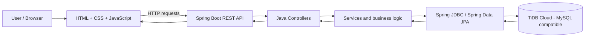

# GroceryMate 🛒

**GroceryMate** is a full-stack grocery and household inventory management web application. It helps household members keep track of grocery stock, record stock updates, understand purchase and spending patterns, and request items from vendors. Vendors can maintain product listings and manage requests and order statuses.

- **Live website:** https://grocery-mate-eight.vercel.app/
- **Backend service:** https://grocerymate-backend.onrender.com
- **Database console:** [GroceryMate database on TiDB Cloud]([https://tidbcloud.com/tidbs/10945827419452629098/overview?orgId=1372813089209377949](https://tidbcloud.com/tidbs/10945827419452629098/sqleditor?orgId=1372813089209377949)

> The frontend and backend are deployed separately. The backend may take a short time to wake up after inactivity on its hosting tier. The TiDB Cloud link is a management-console link, not a public database connection string.

## Contents

- [Problem statement](#problem-statement)
- [Features](#features)
- [Technology stack](#technology-stack)
- [Architecture](#architecture)
- [Screenshots](#screenshots)
- [Run locally](#run-locally)
- [Configuration and deployment](#configuration-and-deployment)
- [API endpoint reference](#api-endpoint-reference)
- [Testing](#testing)
- [User testing notes](#user-testing-notes)
- [Security notes](#security-notes)
- [Possible future improvements](#possible-future-improvements)

## Problem statement

Households often manage grocery supplies and replenishment informally. Without a central record, it can be difficult to know what is in stock, when an item was last purchased, what may need replenishing, and how grocery spending changes over time. Coordinating purchases with local vendors can also require repeated manual communication.

GroceryMate brings household inventory, stock check-ins, purchase history, spending views, reminders, notifications, and vendor order workflows into one application. It also provides a catalog to help users find standard grocery item names.

## Features

### Household / user features

- User sign-up and login with household account creation or joining flow.
- Session-based account handling and logout.
- View household grocery items and stock information.
- Add household items and record stock check-ins.
- Update current stock quantities.
- View item purchase history and stock check-in history.
- View item stock predictions and upcoming purchase suggestions.
- View monthly spending and spending analytics.
- Invite household members and list household members.
- Create grocery purchase requests for household needs.
- Track household orders.
- View notifications, check unread counts, and mark notifications as read.
- Search the grocery catalog, including normalized aliases.

### Vendor features

- Vendor sign-up and login.
- Create, view, edit, and delete the logged-in vendor's product listings.
- View purchase requests available to vendors.
- Accept a purchase request by selecting a product.
- View vendor orders and update order statuses.

### Supporting functionality

- Password hashing through Spring Security's password encoder.
- Backend validation and household/vendor role checks in relevant controller methods.
- CSRF endpoint and CORS configuration for frontend/backend communication.
- Scheduled processing for stock-check and refill reminders, which can generate notifications.
- Automated controller tests for authentication, role access, and invalid input cases.

## Technology stack

| Layer | Technology |
|---|---|
| Frontend | HTML5, CSS3, vanilla JavaScript |
| Backend | Java 17, Spring Boot 3.4.5, Spring Web / REST controllers |
| Security | Spring Security, password encoding, session-based authentication |
| Database | TiDB Cloud (MySQL-compatible SQL database) |
| Data access | Spring JDBC (`JdbcTemplate`) and Spring Data JPA |
| Database driver | MySQL Connector/J |
| Validation | Spring Boot Validation and controller-level validation |
| Build | Apache Maven |
| Testing | JUnit 5, Spring Boot Test, Mockito (through Spring Boot test dependencies) |
| Frontend hosting | Vercel |
| Backend hosting | Render |
| Database hosting | TiDB Cloud |

The current frontend is implemented with plain HTML, CSS, and JavaScript. React, Vue, Bootstrap, and Tailwind are not required by the current codebase.

## Architecture

The main request path is **Browser → JavaScript → API → Java → Database**.



### Deployment layout

- The frontend is published on Vercel.
- The Java Spring Boot backend is hosted on Render.
- The backend connects to TiDB Cloud using a JDBC URL and credentials supplied through environment variables.
- The browser communicates with the backend over HTTP(S); it does not connect directly to the database.

## Screenshots

The following gallery embeds screenshots stored in the repository's `website preview shot` folder. GitHub renders these images directly in this README when the paths match the filenames in that folder.

> **Important:** Replace each example filename below with the exact image filename in `website preview shot` if your uploaded filenames differ. Keep the folder name and spaces exactly as they appear in GitHub.

### Website preview

| Page | Preview |
|---|---|
| Login / Sign up |  |
| Household dashboard |  |
| Stock management |  |
| Vendor dashboard |  |

If your folder uses different names, open `website preview shot` on GitHub, copy each image's exact filename, and update the corresponding image path above. For best results, use descriptive names such as `login-signup.png`, `household-dashboard.png`, `stock-management.png`, and `vendor-dashboard.png`.

Use screenshots captured from the running application. Mask personal information and never include passwords, cookies, CSRF tokens, database credentials, or other secrets.

## Run locally

### Prerequisites

- JDK 17 or later
- Apache Maven 3.8 or later
- A TiDB Cloud or other compatible MySQL database with the required GroceryMate schema and tables
- Git

### 1. Clone the repository

```bash
git clone https://github.com/TejasviMaheshwari/Grocery-Mate.git
cd Grocery-Mate
```

### 2. Configure database connection

The application reads the JDBC URL, username, and password from environment variables. The JPA schema setting is `spring.jpa.hibernate.ddl-auto=none`, so the required schema and tables must already exist; the application will not create the complete schema automatically.

For a local MySQL-compatible database, set environment variables as shown below. Use the actual TiDB Cloud connection details if connecting to the hosted database.

**Linux / macOS:**

```bash
export SPRING_DATASOURCE_URL='jdbc:mysql://HOST:4000/grocerymate?sslMode=VERIFY_IDENTITY'
export SPRING_DATASOURCE_USERNAME='YOUR_DATABASE_USERNAME'
export SPRING_DATASOURCE_PASSWORD='YOUR_DATABASE_PASSWORD'
export CORS_ALLOWED_ORIGINS='http://localhost:8080,http://127.0.0.1:8080'
export SESSION_COOKIE_SECURE='false'
```

**Windows PowerShell:**

```powershell
$env:SPRING_DATASOURCE_URL = 'jdbc:mysql://HOST:4000/grocerymate?sslMode=VERIFY_IDENTITY'
$env:SPRING_DATASOURCE_USERNAME = 'YOUR_DATABASE_USERNAME'
$env:SPRING_DATASOURCE_PASSWORD = 'YOUR_DATABASE_PASSWORD'
$env:CORS_ALLOWED_ORIGINS = 'http://localhost:8080,http://127.0.0.1:8080'
$env:SESSION_COOKIE_SECURE = 'false'
```

Replace the placeholders with your own database connection values. For TiDB Cloud, use the connection details and CA/certificate settings recommended by the TiDB Cloud console for your cluster. Do not commit credentials or production connection strings to GitHub.

### 3. Build and run tests

```bash
mvn clean test
```

### 4. Start the application

```bash
mvn spring-boot:run
```

Open http://localhost:8080. Spring Boot serves the HTML, CSS, and JavaScript files from `src/main/resources/static` and exposes the REST API from the same application.

### 5. Check the service

- Database status: `GET http://localhost:8080/api/database/status`
- CSRF token endpoint: `GET http://localhost:8080/api/csrf`
- Catalog search example: `GET http://localhost:8080/api/catalog/search?q=rice`

Some routes require an authenticated session and the appropriate account role. Use the application's login flow when testing protected features.

## Configuration and deployment

The backend configuration supports the following environment variables:

| Variable | Purpose |
|---|---|
| `PORT` | HTTP server port; defaults to `8080` |
| `SPRING_DATASOURCE_URL` | JDBC connection URL for TiDB Cloud or another compatible database |
| `SPRING_DATASOURCE_USERNAME` | Database username |
| `SPRING_DATASOURCE_PASSWORD` | Database password |
| `CORS_ALLOWED_ORIGINS` | Comma-separated frontend origins; configured in `application.properties` |
| `SESSION_COOKIE_SECURE` | Controls whether the session cookie requires HTTPS |
| `SESSION_COOKIE_SAME_SITE` | Session cookie SameSite policy; defaults to `lax` in application properties |

Set production values in the Render service's environment settings. Configure the frontend API base URL as required by the deployed frontend files. For production, use HTTPS, restrict allowed origins to trusted sites, and keep all credentials in secret/environment settings.

## API endpoint reference

Base URL for the deployed backend: `https://grocerymate-backend.onrender.com`  
Local base URL: `http://localhost:8080`

The following routes are based on the controller mappings in the project source. Request bodies and response formats are defined by the relevant controller and frontend JavaScript. Endpoints that operate on user-specific data should be called through the application's authentication flow.

### Authentication and system

| Method | Endpoint | Purpose |
|---|---|---|
| POST | `/api/auth/signup/user` | Register a household user; can create or join a household based on request fields |
| POST | `/api/auth/signup/vendor` | Register a vendor account |
| POST | `/api/auth/login` | Authenticate and establish the account session |
| GET | `/api/auth/session` | Return information about the current session/account |
| POST | `/api/auth/logout` | Log out the current session |
| GET | `/api/csrf` | Return CSRF token/header information |
| GET | `/api/database/status` | Check database connection and report database/table metadata |

### Catalog

| Method | Endpoint | Purpose |
|---|---|---|
| GET | `/api/catalog/search?q={searchTerm}` | Search catalog items and aliases; terms shorter than two characters return no results |

### Household inventory, spending, and purchase tracking

| Method | Endpoint | Purpose |
|---|---|---|
| GET | `/api/household/items` | List household inventory items |
| POST | `/api/household/items` | Add a household item |
| GET | `/api/household/items/{itemId}/purchases` | View purchase history for an item |
| POST | `/api/household/items/{itemId}/checkins` | Record a stock check-in |
| GET | `/api/household/items/{itemId}/checkins` | View stock check-in history |
| POST | `/api/household/items/{itemId}/stock` | Update stock quantity |
| GET | `/api/household/items/{itemId}/prediction` | Retrieve stock prediction information |
| GET | `/api/household/spending/monthly` | Retrieve monthly spending information |
| GET | `/api/household/spending/analytics` | Retrieve spending analytics |
| GET | `/api/household/purchases/upcoming` | Retrieve upcoming purchase suggestions |
| GET | `/api/household/orders` | Track household orders |

### Household members, invitations, purchase requests, and notifications

| Method | Endpoint | Purpose |
|---|---|---|
| GET | `/api/household/members` | List members of the current household |
| POST | `/api/household/invitations` | Create a household invitation |
| POST | `/api/household/invitations/accept` | Accept a household invitation |
| POST | `/api/household/requests` | Create a grocery purchase request |
| GET | `/api/household/notifications` | List notifications; supports an optional `limit` query parameter |
| GET | `/api/household/notifications/unread-count` | Get the unread notification count |
| PATCH | `/api/household/notifications/{notificationId}/read` | Mark one notification as read |
| PATCH | `/api/household/notifications/read-all` | Mark all notifications as read |

### Vendor products and order workflow

| Method | Endpoint | Purpose |
|---|---|---|
| GET | `/api/vendor/products` | List products belonging to the signed-in vendor |
| POST | `/api/vendor/products` | Create a vendor product |
| PUT | `/api/vendor/products/{productId}` | Update a vendor product |
| DELETE | `/api/vendor/products/{productId}` | Delete a vendor product |
| GET | `/api/vendor/requests` | List purchase requests available to the vendor |
| POST | `/api/vendor/requests/{requestId}/accept` | Accept a purchase request with a selected product |
| GET | `/api/vendor/orders` | List vendor orders |
| PATCH | `/api/vendor/orders/{orderId}/status` | Update an order status |

**Example request bodies**

Accept a purchase request:

```json
{
  "productId": 4
}
```

Update an order status:

```json
{
  "status": "PROCESSING"
}
```

For exact fields, allowed status values, and response formats, consult the matching controller and service code. Access requirements and validation are enforced in the application code and may differ by route.

## Testing

The repository contains `src/test/java/com/grocerymate/HouseholdControllerTest.java`, with five JUnit test methods covering household inventory access and input validation:

| Test | Expected behavior |
|---|---|
| `getItemsWithoutAuthenticationReturnsUnauthorized` | An unauthenticated request to list household items returns `401 Unauthorized` |
| `getItemsWithInvalidPrincipalReturnsUnauthorized` | An invalid authenticated principal returns `401 Unauthorized` |
| `getItemsWithVendorRoleReturnsForbidden` | A vendor account attempting a household-only operation returns `403 Forbidden` |
| `addStockCheckinWithoutRequiredFieldsReturnsBadRequest` | A stock check-in missing required fields returns `400 Bad Request` |
| `updateStockWithNegativeQuantityReturnsBadRequest` | A stock update with a negative quantity returns `400 Bad Request` |

Run the tests with:

```bash
mvn test
```

These are automated controller tests; they should not be described as complete end-to-end tests. Record the actual command result and any failures when running the tests in your own environment.

## User testing notes

Fill in this table after collecting feedback from real users or evaluators. Do not list a person as a tester or quote feedback unless the test actually happened.

| Tester (name or role, with permission) | What they tested | Feedback / issue reported | Change made | Retest result |
|---|---|---|---|---|
| Add actual tester | Sign-up and login | Add their actual feedback | Describe the change, or write “No change yet” | Pass / fail / not retested |
| Add actual tester | Household stock management | Add their actual feedback | Describe the change, or write “No change yet” | Pass / fail / not retested |
| Add actual tester | Vendor product/order workflow | Add their actual feedback | Describe the change, or write “No change yet” | Pass / fail / not retested |

If no external user testing has been completed, state that clearly in your submission and distinguish your own developer checks from independent user testing.

## Security notes

- Never commit database usernames/passwords, API secrets, session cookies, or production credentials.
- Do not connect to TiDB Cloud directly from browser JavaScript. Database access belongs in the backend.
- The TiDB Cloud console URL is a management link and does not replace JDBC configuration.
- Use HTTPS and secure cookie settings in production.
- Limit database privileges and allowed CORS origins to what the application requires.
- Use test data in screenshots and mask personal or identifying information.

## Possible future improvements

- Add screenshots and a short walkthrough GIF/video.
- Expand automated tests to cover authentication, vendor workflows, purchase requests, notifications, and database integration.
- Add integration/end-to-end tests against a dedicated test database.
- Add API documentation with request/response examples and error responses.
- Improve deployment health checks and monitoring.

---

Developed as a full-stack project using Java, Spring Boot, JavaScript, and TiDB Cloud.
